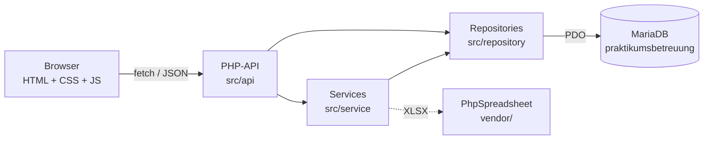
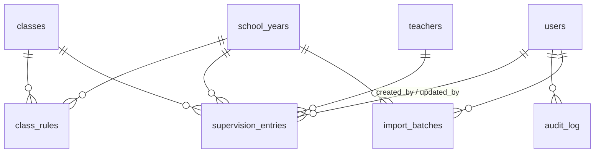

# Architektur – Praktikumszeiterfassung

Kurzüberblick über Aufbau und Datenfluss. Fachliche Entscheidungen und offene Punkte stehen in [PROJEKT.md](PROJEKT.md).

## Überblick

Klassische Drei-Schichten-Anwendung ohne Framework und ohne Build-Schritt:

| Schicht | Ort | Aufgabe |
|---|---|---|
| Frontend | `src/html`, `src/css`, `src/js`, `src/img` | Statische Seiten. Je Seite ein Skript (`zeitbuchungen.js`, `klassen.js`, `lehrkraefte.js`) plus `gemeinsam.js`. Laden per `fetch`, filtern und rendern. Keine Fachlogik |
| API | `src/api/*.php` | Ein Skript je Ressource. Prüft Eingaben, ruft Services und Repositories auf, antwortet mit JSON |
| Services | `src/service` | Fachlogik: Berechnung nach Spezifikation 4.2, Excel-Import und -Export |
| Repositories | `src/repository` | Einziger Ort mit SQL. Prepared Statements über PDO |
| Datenbank | `src/database` | MariaDB-Dump (Schema, Stammdaten, Bestandseinträge) und Nachtrags-Skripte: Klassenwerte aus Spezifikation 4.1, fehlende Einträge aus der Excel-Vorlage |

## Komponenten

**API** (`src/api`)
- `bootstrap.php`: Autoloader (`App\X\Y` → `src/x/Y.php`), PDO-Verbindung (`db()`), `antworte()` für JSON, zentrale Fehlerbehandlung (Validierungsfehler → 422, sonst 500 ohne Details).
- `stammdaten.php`: Schuljahre, Klassen, Lehrkräfte für Auswahllisten.
- `klassen.php`: Klassen mit Werten und Stunden lesen, Faktor und Wochen setzen.
- `lehrkraefte.php`: Lehrkräfte mit Stunden lesen, anlegen, ändern, löschen (nur ohne Einträge).
- `eintraege.php`: Einträge lesen (`GET`), anlegen (`POST`), bearbeiten (`PUT`), löschen (`DELETE`).
- `export.php`: XLSX-Download, gesamt oder für eine Lehrkraft.
- `import.php`: XLSX-Upload, ersetzt die Einträge eines Schuljahres.

**Services** (`src/service`)
- `InternshipHoursCalculator`: einzige Stelle der Berechnung. `calculateEntry()` (aktuelle Klassenwerte), `withSnapshot()` (vorgegebener Faktor und Wochen), `summarizeByTeacher()` (Summen HJ1, HJ2, Schuljahr und Kontrollwert). Rundung auf 3 Stellen.
- `ExcelExportService`: drei Blätter (Praktikumsbetreuung I, II, Zusammenfassung je Lehrkraft).
- `ExcelImportService`: liest dasselbe Format, prüft alle Zeilen, speichert nur fehlerfreie Dateien.

**Repositories** (`src/repository`)
- `SupervisionEntryRepository`: Einträge inkl. Transaktionen und `audit_log`.
- `ClassRuleRepository`: Klassenwerte (Faktor, Wochen je Halbjahr) je Klasse und Schuljahr lesen und setzen.
- `ClassRepository`: Klassen, auch mit Werten und Stunden je Schuljahr.
- `TeacherRepository`: Lehrkräfte lesen, anlegen, ändern, löschen.
- `SchoolYearRepository`: Schuljahre.
- `AuditLogRepository`: Zeile in `audit_log` schreiben (genutzt von Klassen- und Lehrkraft-Änderungen).
- `ImportBatchRepository`: Protokoll jedes Importversuchs.

**Model** (`src/model`)
- `ClassRule`: unveränderliches Wertobjekt mit Validierung.

## Datenmodell

- `supervision_entries` ist die Kerntabelle: ein Eintrag je Halbjahr, Klasse, Lehrkraft und Schülerzahl.
- **Snapshot-Prinzip:** Faktor und Wochen werden beim Speichern in den Eintrag kopiert (`factor_snapshot`, `weeks_snapshot`), zusammen mit den berechneten Stunden. Spätere Änderungen in `class_rules` verändern bestehende Einträge nicht.
- `audit_log` protokolliert Bearbeiten und Löschen von Einträgen, Import, Änderungen an Klassenwerten (`update_rule`) und Lehrkräften (`create`, `update`, `delete`). Gespeichert werden nur Aktion und ID, keine alten Werte.
- `users`, `user_class_assignments`: vorbereitet für die Anmeldung (Konzept in [KONZEPT-ANMELDUNG.md](KONZEPT-ANMELDUNG.md)). Bis dahin ist User 1 (`system-import`) fest der Bearbeiter.

## Abläufe

**Eintrag anlegen**
1. Das Formular schickt Klasse, Lehrkraft, Schülerzahl und Halbjahr per `POST` an `eintraege.php`.
2. Der Calculator holt Faktor und Wochen aus `class_rules` und berechnet `Faktor × Schüler × Wochen / 40`, gerundet auf 3 Stellen. Hat die Klasse im Halbjahr keine Wochen, lehnt er mit 422 ab (das Formular blendet solche Klassen schon aus).
3. Das Repository speichert den Eintrag samt Snapshot.
4. Das Frontend lädt die Liste neu. Die Summen je Lehrkraft kommen fertig berechnet vom Server.

**Bearbeiten:** Wie Anlegen, aber mit `PUT`. Es wird mit den aktuellen Klassenwerten neu gerechnet. Update und `audit_log` laufen in einer Transaktion.

**Import**
1. `import.php` prüft den Upload: höchstens 5 MB, nur `.xlsx`, echte Upload-Datei.
2. Der Service prüft Blätter und Überschriften. Danach liest er alle Zeilen und sammelt jeden Zeilenfehler.
3. Unveränderte Zeilen übernehmen die exakt gespeicherten Stunden des bisherigen Eintrags. Geänderte Zeilen werden mit Faktor und Wochen aus der Datei berechnet, neue Zeilen ohne Faktor und Wochen mit den Klassenwerten.
4. Hat die Datei Fehler, wird nichts geändert. Ist sie fehlerfrei, werden in **einer Transaktion** alle Einträge des Schuljahres gelöscht und neu eingefügt.
5. Jeder Versuch, auch ein abgelehnter, landet in `import_batches`.

## Querschnittsthemen

- **Sicherheit:**
  - Alle SQL-Zugriffe nutzen Prepared Statements.
  - Das Frontend escaped alle DB-Texte vor dem Rendern (`esc()`).
  - Fehlermeldungen geben keine Serverpfade oder Stacktraces preis.
  - Formeln in importierten Eingabezellen werden abgelehnt.
  - Authentifizierung und Rechteprüfung fehlen noch, Konzept in [KONZEPT-ANMELDUNG.md](KONZEPT-ANMELDUNG.md).
  - Der Webroot ist das Repo-Root. SQL-Dumps und `vendor/` sind damit per HTTP abrufbar. Vor dem Produktivbetrieb sperren.
- **Konsistenz:** Mehrschrittige Schreibvorgänge laufen in Transaktionen (Bearbeiten, Löschen, Import, Klassenwerte, Lehrkräfte, jeweils mit `audit_log`).
- **Konfiguration:** Optional `src/config.php` (nicht im Git) mit DSN, Benutzer und Passwort. Ohne die Datei gelten die XAMPP-Standardwerte.
- **Abhängigkeiten:** PHP ≥ 8.2 mit `pdo_mysql`, `gd`, `zip` (in `composer.json` festgelegt, `config.platform.php` = 8.2.0). Composer installiert PhpSpreadsheet `^3.10` (`vendor/` ist nicht im Git). Im Frontend keine Bibliotheken.
- **Sprache:** Oberfläche, API-Fehlermeldungen und Doku sind deutsch. Code-Bezeichner sind gemischt: Fachlogik englisch, API und Frontend deutsch.
